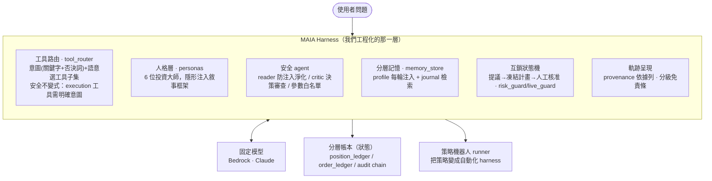

# MAIA 作為一個 Harness — 架構的學術定位

> **一句話**：MAIA 不只是「接了一個 LLM」，而是圍繞一個**固定的模型**（AWS Bedrock 上的 Claude）刻意工程化的一層 **harness** —— 決定「存什麼、取什麼、給模型看什麼」的程式碼。最新研究（Meta-Harness, Lee et al. 2026）指出：**同一個模型換 harness 可以有 6× 的表現差距，harness 往往和模型本身一樣重要**。MAIA 正是一個在**高風險領域（加密交易 + 合規）做 harness 工程**的案例。

---

## 1. 什麼是 harness

引用 *Meta-Harness: End-to-End Optimization of Model Harnesses*（arXiv:2603.28052, Lee, Nair, Zhang, Lee, Khattab, Finn, 2026）：

> The performance of large language model (LLM) systems depends not only on model weights, but also on their **harness**: the code that determines what information to store, retrieve, and present to the model.

**harness** = 一個包住 LLM 的**有狀態程式**，在每一步決定模型看到什麼 context、能用哪些工具、如何更新狀態。論文的三個關鍵論點：

1. **harness 決定成敗**：換 harness 可造成 6× 表現差距；harness engineering 是 LLM 應用價值的核心。
2. **harness 至今大多手工設計**：實務上由工程師檢查失敗、調整啟發式、迭代。
3. **可自動優化**：Meta-Harness 用一個 coding agent（Claude Code + Opus）當提議者，對 harness 程式碼做外層搜尋，靠的是**完整的執行軌跡**（所有候選的原始碼 + trace + 分數，透過檔案系統存取），而非壓縮摘要。

---

## 2. MAIA 的 harness 分層

MAIA 的架構就是一層 harness：使用者的問題進來，harness 決定人格框架、選哪些工具、淨化外部內容、注入哪段記憶、要不要人工核准、把什麼軌跡攤給使用者看——固定的 Bedrock Claude 只負責推理。

---

## 3. 元件對照表 — MAIA 的每個設計都是一個 harness 決策

| harness 概念（論文） | MAIA 的對應實作 | 位置 |
|---|---|---|
| 決定**給模型看哪些工具** | 意圖判定（關鍵字 + `_INFO_VETO` 否決）＋ 語意相似度補救選工具子集；**語意 fallback 絕不引入 execution 工具**（下單須明確意圖） | `agent/tool_router.py` |
| **context 框架 / priming** | 6 位投資大師人格，隱形注入 system prompt 改變分析優先序與語氣（不改工具集）；`CORE` 工具永遠在場 | `agent/personas.py` |
| **狀態驗證 / 淨化** | `reader_agent` 淨化不可信外部內容（防提示注入）、`critic_agent` 在含買賣建議時審查決策、`_sanitize_tool_args` 參數白名單擋 `mode=live` 注入 | `agent/ollama_agent.py`、`agent/reader_agent.py`、`agent/critic_agent.py` |
| **自適應存取記憶** | 分層記憶：`profile.json`（使用者偏好，每輪注入 context）+ `journal.jsonl`（交易日誌，近期注入 + `recall_history` 關鍵字搜尋） | `agent/memory_store.py` → `agent_memory/` |
| **把軌跡呈現給使用者** | provenance「依據列」把 MAIA 查了什麼、依據什麼攤在答案下方；分級免責條 | `frontend-pixel`（provenance/disclaimer）＋ `routing_log.jsonl` |
| **安全互鎖（狀態機）** | 下單一律「提議 → 凍結計畫（SHA256）→ 人工核准 → 依凍結計畫執行」；`RISK_MODE` paper/live 預設 paper；`risk_guard` 單筆物理鎖；`live_guard` 停手/授權到期/累計曝險 | `agent/trade_approval.py`、`skills/execution/{order_executor,risk_guard,live_guard}.py` |
| **把策略變成自主 loop** | 策略機器人 runner：daemon 迴圈抓真實 MAX K 線 → 用與回測同一套訊號評估 → 模擬成交 → 寫 per-bot 台帳（全 paper） | `agent/strategy_bots.py` |

### 3.1 最強的具體對應：routing

Meta-Harness 在數學推理任務**自動搜尋 40 輪長出來**的 harness，核心是一個 **lexical router → 分主題檢索**（組合/幾何/數論/其他各自不同的檢索策略，見論文 Fig. 8）。

**MAIA 的 `tool_router` 就是手工版的同一件事**：把問題的意圖分流到分領域的工具子集，並用語意相似度補救 recall。論文花大量算力**搜尋**出來的 routing 結構，正是我們**刻意手工設計**的核心。

---

## 4. 狀態層 — 「決定存什麼」的三層設計（合規級）

harness 的一個核心是「what to store」。MAIA 的狀態刻意分三層，且最外層是**合規等級**的：

| 層 | 角色 | 檔案 | 落地 |
|---|---|---|---|
| ① 使用者記憶（會回讀進 context） | 個人化與跨對話連續性 | `agent/memory_store.py` | `agent_memory/profile.json`、`journal.jsonl`（gitignore，私有） |
| ② 交易事件帳本 | 持倉 / 已實現・未實現損益（從 MAX 成交、閃兌、出入金彙整、依 uid 去重） | `skills/analytics/position_ledger.py` | `conversation_logs/position_ledger.jsonl` |
| ② 下單決策台帳 | 每筆下單決策（SUBMITTED / REJECTED_* / HALTED），含被擋下的 | `skills/execution/live_guard.py`（`record_decision`） | `conversation_logs/order_ledger.jsonl` |
| ③ 不可竄改審計鏈 | 合規：每個決策迴圈上鏈，`chain_hash = sha256(prev_hash + current_hash)`，改一筆全鏈對不上 | `agent/audit_logger.py` | `audit_logs/decisions.jsonl` |

`memory_store.py` 檔頭自述「與 `audit_logger`（不可變合規審計）**互補**」：一邊是**會被回讀進 context 的記憶**，一邊是**改不動的審計**。這正是 harness 的「決定存什麼」工程，且帶了對信託保管 / AML 法遵評審特別有份量的合規轉折。

---

## 5. 誠實邊界（很重要）

- ❌ **不宣稱**：MAIA「使用 Meta-Harness」或「自動優化了 harness」。MAIA 是**手工工程化的 harness**，不是外層搜尋的產物。
- ✅ **宣稱**：MAIA 是 **harness engineering 的一個實例**；這篇論文是**外部驗證**——「LLM 應用的價值在 harness 這一層」，而我們正是把力氣花在這裡。

## 6. 兩個加分且真實的角度

1. **MAIA 是「Meta-Harness-ready」的**：MAIA 已在寫 `conversation_logs/routing_log.jsonl`（每題的意圖 / 工具 / 信心分數）與 `audit_logs/decisions.jsonl` 審計鏈——**這正是論文說「能啟動 harness 自動優化」所需的完整執行軌跡**。所以「**未來工作：對 MAIA 的 router / prompt 跑 Meta-Harness 外層搜尋**」是站得住的 roadmap，不是空話。
2. **開發流程本身呼應論文**：Meta-Harness 的提議者就是 **Claude Code**；MAIA 的這層 harness 也是用 agentic coding（Claude Code）迭代出來的——我們的開發方法本身就與論文的方法一致。

---

## 7. Pitch 講點（電梯簡報）

- 「LLM 應用的價值不只在模型，更在 **harness** —— 圍繞模型、決定存什麼/取什麼/給它看什麼的那層程式碼。最新研究指出換 harness 可有 **6× 差距**。」
- 「**MAIA 就是一個 harness**：工具路由、隱形人格、防注入淨化、分層記憶、提議→凍結→核准的安全互鎖、依據列軌跡——固定的 Bedrock Claude 只負責推理。」
- 「論文**自動搜尋**出來的核心結構是 *routing*；我們**手工設計**的核心也是 routing（`tool_router`）——不謀而合。」
- 「我們的狀態刻意分三層，最外層是**不可竄改的合規審計鏈**——這是為信託 / AML 場景設計的 harness。」
- 「而且我們已經在記錄完整執行軌跡（routing_log / 審計鏈），所以 MAIA 是 **Meta-Harness-ready**：下一步就能對自己的 harness 跑自動優化。」

---

## 引用

Yoonho Lee, Roshen Nair, Qizheng Zhang, Kangwook Lee, Omar Khattab, Chelsea Finn.
*Meta-Harness: End-to-End Optimization of Model Harnesses.* arXiv:2603.28052, 2026.
專案頁：https://yoonholee.com/meta-harness/
