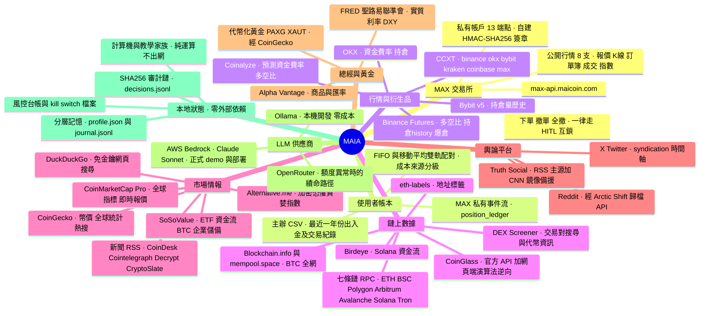
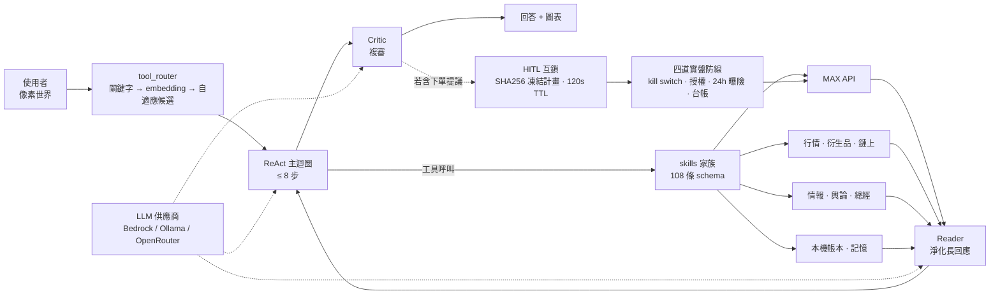

# MAIA 資料源地圖

> 以 agent 為中心，盤點它實際串接的每一個外部資料源。
> 來源：`agent-core/skills/`（9 家族 · 108 條工具 schema）與 `agent-core/agent/`。

---

## 一、放射圖：MAIA 與它的資料源

---

## 二、資料如何流過 agent

---

## 三、資料源清單

| 分類 | 資料源 | 主機 | 金鑰 | 用途 |
|---|---|---|---|---|
| **MAX** | MAX 公開 API | `max-api.maicoin.com` | 免 | 行情、K 線、訂單簿、成交、指數、利率 |
| **MAX** | MAX 私有 API | `max-api.maicoin.com` | Lv2 API Key | 帳戶、委託、成交、出入金、換幣、下單撤單 |
| **帳本** | 主辦 CSV | 本機 `data_set/` | 免 | 訪客示範帳戶種子（離線可跑） |
| **行情** | CCXT | 6 家交易所 | 免（公開） | 統一 K 線 / ticker / 訂單簿 |
| **衍生品** | Binance Futures | `fapi.binance.com` | 免 | 多空比、持倉量歷史、爆倉 |
| **衍生品** | Bybit | `api.bybit.com` | 免 | 持倉量歷史 |
| **衍生品** | OKX | `www.okx.com` | 免 | 資金費率、持倉 |
| **衍生品** | Coinalyze | `api.coinalyze.net` | 免費層 | 預測資金費率、多空比 |
| **鏈上** | CoinGlass | `open-api-v4.coinglass.com` + 網頁逆向 | 部分免 | 爆倉熱力圖、AHR999、山寨季、ETF 流、Mayer |
| **鏈上** | DEX Screener | `api.dexscreener.com` | 免 | DEX 交易對與代幣資訊 |
| **鏈上** | Birdeye | `public-api.birdeye.so` | 免費層 | Solana 資金流 |
| **鏈上** | Blockchain.info / mempool.space | 同名 | 免 | BTC 全網統計、未確認交易 |
| **鏈上** | 七條鏈公開 RPC | llamarpc / polygon-rpc / bsc-dataseed / arbitrum / avax / solana / tronscan | 免 | 跨鏈追蹤入金來源 |
| **情報** | CoinMarketCap Pro | `pro-api.coinmarketcap.com` | 需 Key | 全球指標、即時報價 |
| **情報** | CoinGecko | `api.coingecko.com` | 免費層 | 幣價、全球統計、熱搜、黃金代幣 |
| **情報** | Alternative.me | `api.alternative.me` | 免 | 恐懼貪婪指數 |
| **情報** | SoSoValue | `openapi.sosovalue.com` | 需 Key | ETF 資金流、BTC 企業儲備 |
| **情報** | 新聞 RSS ×4 | CoinDesk / Cointelegraph / Decrypt / CryptoSlate | 免 | 最新加密新聞 |
| **情報** | DuckDuckGo | `ddgs` 套件 | 免 | 即時網頁搜尋 |
| **輿論** | X (Twitter) | `syndication.twitter.com` | 免 | 指定帳號時間軸、提及回測 |
| **輿論** | Reddit | `arctic-shift.photon-reddit.com` | 免 | r/cryptocurrency 討論熱度 |
| **輿論** | Truth Social | `trumpstruth.org` + `ix.cnn.io` 鏡像 | 免 | 政治發文事件研究 |
| **總經** | FRED | `api.stlouisfed.org` | 需 Key | 實質利率、DXY |
| **總經** | Alpha Vantage | `www.alphavantage.co` | 免費層 | 商品與匯率 |
| **LLM** | AWS Bedrock | `bedrock-runtime` (us-west-2) | IAM | 正式 demo 與部署 |
| **LLM** | Ollama | `localhost:11434` | 免 | 本機開發 |
| **LLM** | OpenRouter | `openrouter.ai` | 需 Key | 備援 |
| **本地** | 分層記憶 / 審計鏈 / 風控台帳 | 本機檔案 | — | 偏好、決策紀錄、曝險、kill switch |

> 三個 **X / Threads / Truth Social** 命題點名的輿論平台，本專案接了 X 與 Truth Social；
> Threads 無公開讀取端點，改以 Reddit 補社群情緒維度。

---

## 四、對外提供的介面

| 介面 | 協定 | 位置 |
|---|---|---|
| MAX MCP Server | streamable-http | `agent-core/mcp_servers/max_mcp_server.py` |
| AgentCore Runtime | `/invocations` SSE + `/ping` | `agent-core/deploy/agentcore_app.py` |
| FastAPI 服務 | REST（25 條路由） | `agent-core/agent_ui/app.py` |
